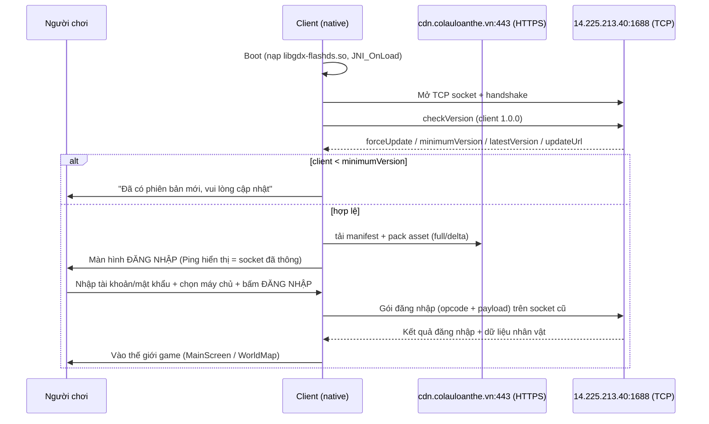
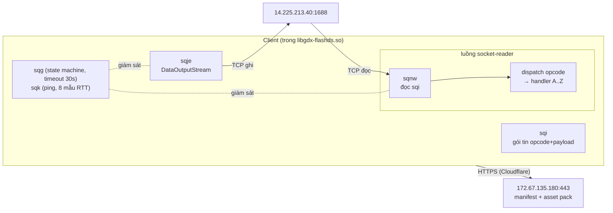

# Cờ Lau Loạn Thế: luồng đăng nhập và giao tiếp với server

Tài liệu này bổ sung cho [kien-truc-apk.md](kien-truc-apk.md), tập trung vào **luồng đăng nhập** và **cách client nói chuyện với máy chủ**. Khác với tài liệu kia (hoàn toàn tĩnh), phần này có thêm **phân tích động**: chạy app thật trên thiết bị đã kết nối qua ADB và quan sát.

Đánh dấu độ chắc chắn: **[Quan sát]** đọc trực tiếp (runtime hoặc file), **[Suy luận]** gộp nhiều quan sát, **[Chưa rõ]** chưa xác định được bằng cách đang dùng.

Môi trường: Xiaomi M2101K7BG (Android), app `com.lotasoft.colauloanthe`, UID `10315`. Thiết bị **không root**, app **không debuggable**.

---

## 1. Kết luận nhanh

| Câu hỏi | Trả lời |
|---|---|
| Kết nối server kiểu gì? | **TCP socket thô, giao thức nhị phân tự định nghĩa**, không phải HTTP/WebSocket [Quan sát + Suy luận] |
| Server game | `14.225.213.40:1688` (IP Việt Nam) — ứng với `play.colauloanthe.vn` [Quan sát runtime] |
| CDN tải asset | `172.67.135.180:443` qua HTTPS, dải **Cloudflare** — ứng với `cdn.colauloanthe.vn` [Quan sát runtime] |
| Khi nào mở socket? | Ngay lúc **boot**, trước màn hình đăng nhập [Quan sát: socket đã ESTABLISHED và có Ping 25ms tại màn login] |
| Đăng nhập đi qua đâu? | Qua **chính socket 1688 đã mở sẵn**, không tạo kết nối mới [Quan sát: bấm Đăng nhập không sinh kết nối nào mới] |
| Payload socket có mã hoá không? | **Có, ở tầng native.** Khung ngoài (độ dài + opcode + "PT01") là cleartext; phần dữ liệu được mã hoá. Gói login mang **64 byte credential đã mã hoá**; stream server dùng scheme **lộ cấu trúc** (xem mục 7) [Quan sát từ byte bắt được] |
| Đã bắt được byte thật chưa? | **Rồi** — hook libc `sendto`/`recvfrom` bằng Frida (máy đã root), bắt 262 gói gồm cả gói đăng nhập (mục 7) |
| Đăng nhập thành công? | Có — vào thẳng thế giới game (nhân vật `manina`, Làng Thanh Khê) [Quan sát] |

---

## 2. Cách quan sát (phân tích động)

Tất cả chỉ dùng công cụ không cần root:

```bash
D=192.168.2.3:5555   # thiết bị qua Wi-Fi

# Khởi động lại sạch và xem log quá trình nạp native
adb -s $D shell am force-stop com.lotasoft.colauloanthe
adb -s $D logcat -c
adb -s $D shell monkey -p com.lotasoft.colauloanthe 1

# Lấy UID của app
adb -s $D shell dumpsys package com.lotasoft.colauloanthe | grep userId=   # -> 10315

# Xem mọi kết nối TCP do app sở hữu (cột 8 = uid thập phân)
adb -s $D shell "cat /proc/net/tcp /proc/net/tcp6" | awk '$8==10315{print $2,$3,$4}'

# Chụp màn hình để xác định đang ở màn nào
adb -s $D exec-out screencap -p > screen.png

# Điều khiển UI từ xa
adb -s $D shell input tap <x> <y>
```

Địa chỉ trong `/proc/net/tcp` là hex, từng byte đảo thứ tự (little-endian). Ví dụ `28D5E10E` → `0E.E1.D5.28` → **14.225.213.40**; cổng `0698` = **1688**.

---

## 3. Những gì quan sát được khi chạy

### 3.1 Nạp thư viện (logcat)

```
I ft.colauloanthe: Using generational CollectorTypeCC GC.
D ft.colauloanthe: JNI_OnLoad success
D NetworkSecurityConfig: Using Network Security Config from resource network_security_config debugBuild: false
D nativeloader: Load .../lib/arm64-v8a/libgdx-flashds.so using class loader ...
D nativeloader: Load .../lib/arm64-v8a/libgdx.so using class loader ...
I AndroidGraphics: OGL renderer: Mali-G76 / OpenGL ES 3.2
```

- Game **không tự ghi log nghiệp vụ ra logcat** (các chuỗi tiếng Việt trong code không xuất hiện ở logcat). Muốn đọc log nội bộ phải lấy file log riêng trong vùng dữ liệu của app (cần root hoặc app debuggable — ở đây đều không có).
- Có `network_security_config` tuỳ chỉnh (`res/xN.xml` trong APK). `debugBuild: false`.

### 3.2 Kết nối mạng tại màn hình đăng nhập [Quan sát]

Bảng TCP của UID 10315 (st `01` = ESTABLISHED):

| Local | Remote | Trạng thái | Ý nghĩa |
|---|---|---|---|
| 192.168.2.3:38648 | **14.225.213.40:1688** | ESTABLISHED | Socket game (raw TCP) |
| 192.168.2.3:37778 | **172.67.135.180:443** | ESTABLISHED | HTTPS tới CDN (Cloudflare) |

Màn hình đăng nhập hiển thị góc dưới **"FPS: 61 | Ping: 25ms"** → socket game đã thông và đang đo RTT. Nghĩa là **socket mở ngay khi boot**, trước khi người dùng đăng nhập.

### 3.3 Màn hình đăng nhập [Quan sát]

Hộp "ĐĂNG NHẬP" gồm:

- Ô tài khoản (đã nhớ sẵn, do có tính năng "Ghi nhớ đăng nhập" được tích).
- Ô mật khẩu (ẩn).
- "Ghi nhớ đăng nhập" (checkbox), "Quên mật khẩu?".
- Chọn máy chủ: ví dụ "Thanh Khê" kèm chấm xanh (online) và nút CHỌN.
- Nút **ĐĂNG NHẬP** và **ĐĂNG KÝ**.
- Checkbox đồng ý Điều khoản / Chính sách bảo mật (mở bằng trình duyệt tới `lotasoft.vn`).
- Góc phải trên: "Phiên bản: 1.0.0". Góc phải dưới: "Xóa dữ liệu".

### 3.4 Đăng nhập [Quan sát]

Bấm ĐĂNG NHẬP (`adb shell input tap`):

- **Không có kết nối TCP mới nào xuất hiện.** Socket 1688 vẫn là kết nối cũ (cùng cổng nguồn 38648). → Gói đăng nhập được gửi trên **chính socket đã mở sẵn**.
- Có tiếng động phát ra (logcat `AudioALSAHardware app_name=com.lotasoft.colauloanthe`).
- Màn hình chuyển vào **thế giới game**: nhân vật `manina` (cấp 3, HP 120/130), bản đồ "Làng Thanh Khê – Khu vực 2", bảng nhiệm vụ "Những Việc Đầu Tiên", menu (Bản đồ, Cộng đồng, Tích lũy, Lôi đài, Chợ trời, Nạp đầu, Phúc lợi, Tài khoản, Sự kiện, Chức năng), joystick ảo + nút tấn công.

---

## 4. Luồng đăng nhập (dựng lại)



- Bước Boot/checkVersion lấy từ chuỗi trong native (xem [kien-truc-apk.md](kien-truc-apk.md) mục 5). Việc socket mở tại Boot và login dùng lại socket đó là **[Quan sát runtime]**.
- checkVersion đi qua socket hay HTTP: **[Chưa rõ]**. Nhưng vì socket đã ESTABLISHED và có Ping ngay tại màn login, nhiều khả năng handshake/checkVersion đi qua socket [Suy luận].
- Tài khoản/mật khẩu "ghi nhớ" được lưu cục bộ (có thể trong `clloanthe.db` hoặc store nội bộ) và rất có thể mã hoá bằng lớp AES `com.e.sqa` [Suy luận] — chỗ lưu chính xác và có mã hoá hay không: **[Chưa rõ]**.

---

## 5. Cấu trúc giao thức (từ các lớp Java)

Dù thân hàm nằm trong native, **chữ ký hàm và field** trong `classes.dex` đã lộ rõ khung giao thức. Các lớp mạng nằm ở `com.mh` và `com.mh.n`.

### 5.1 Gói tin: `com.mh.n.sqi` [Quan sát]

```java
public final class sqi {
    public final int f3140a;   // opcode (loại message), đặt khi tạo: new sqi(opcode)
    private byte[] f3141b;      // buffer payload (mặc định 1024 byte)
    private int f3142c, f3143d; // con trỏ đọc / ghi
    // API ghi (fluent, trả về sqi để nối chuỗi):
    native sqi a(long);  native sqi a(String); native sqi a(short);
    native sqi a(boolean); native sqi a(byte[]); native sqi b(int); ...
    // API đọc:
    native byte a();  native short b(); native int c(); native long d();
    native boolean e(); native String f(); native byte[] g(); ...
}
```

→ `sqi` là **bộ đệm gói tin hai chiều**: một message = `opcode (int) + payload`, với các hàm put/get cho kiểu nguyên thuỷ và chuỗi. Giống lớp "Message/Packet" kinh điển của game online.

### 5.2 Bộ gửi: `com.mh.sqje` [Quan sát]

```java
final class sqje {
    private DataOutputStream f4537b;
    sqje(OutputStream os) {
        this.f4537b = new DataOutputStream(new BufferedOutputStream(os, 4096));
    }
    native void a(com.mh.n.sqi sqi);  // gửi một gói
    native void a();                   // flush
}
```

→ Gửi = tuần tự hoá `sqi` (opcode + payload) ra `DataOutputStream`. Dùng `DataOutputStream` nên nhiều khả năng mỗi gói có **tiền tố độ dài** rồi tới opcode và payload [Suy luận].

### 5.3 Bộ đọc + điều phối: `com.mh.sqnw` ("SocketReader") [Quan sát]

```java
public final class sqnw implements Runnable {
    sqnw(InputStream is, ...) {
        this.f5034h = new sqjd(is);               // bọc InputStream
        new Thread(this, "socket-reader").start(); // luồng đọc riêng
    }
    // hàng loạt handler nhận một gói đã parse:
    native void A(com.mh.n.sqi), B(...), C(...), ... Z(...), và nhiều hàm khác
    native void a(int opcode, com.mh.n.sqi msg);  // điều phối theo opcode
}
```

→ Một luồng nền `socket-reader` đọc từng `sqi` từ socket, rồi `a(opcode, msg)` **dispatch sang handler tương ứng** (A, B, C…). Mỗi handler xử lý một loại message từ server (cập nhật bản đồ, kết quả trận, chat, vật phẩm…).

### 5.4 Quản lý kết nối: `com.mh.n.sqg` + `sqk` [Quan sát]

- `sqg`: máy trạng thái kết nối, 4 trạng thái (0–3), timeout **30000 ms**, chuỗi "Đang kết nối máy chủ..." / "Mất kết nối..." / "Máy chủ không phản hồi...". Có reconnect.
- `sqk`: vòng đệm **8 mẫu** `long` (RTT), mốc 1000/2000 ms → tính **Ping** hiển thị ở màn hình.
- `com.mh.sqni`: mở `Socket(host, port, timeout=8000ms)`, phân giải DNS (`InetAddress[] a(String, long)`), xử lý `server yeu cau chuyen IP` (server chỉ định IP khác).

### 5.5 Mã hoá trên socket? [Quan sát + Suy luận]

- **Không lớp mạng nào** (`com.mh`, `com.mh.n`) tham chiếu lớp AES `com.e.sqa`. AES chỉ dùng cho asset `.dat`.
- Vậy ở tầng Java, payload socket là **nhị phân thô, không mã hoá**. Tầng native có chèn thêm một lớp xáo trộn/mã hoá byte hay không thì **[Chưa rõ]** (phải dịch ngược native mới biết).

---

## 6. Sơ đồ tổng thể giao tiếp



---

## 7. Bắt gói thật bằng Frida (đã thực hiện)

Máy **đã root sẵn (Magisk)** nên dùng được Frida mà không cần đóng gói lại APK.

**Cách làm:** chạy `frida-server` (root) trên máy, spawn game bằng Frida kèm script hook **syscall libc** `sendto`/`recvfrom`/`send`/`recv`/`read`/`write`, lọc theo socket nối cổng 1688, rồi in hexdump. Hook ở tầng syscall nên **bắt được byte thật trên dây** bất kể native có xáo trộn hàm thế nào.

```bash
# frida-server (root) đã có ở /data/local/tmp/frida-server
adb -s $D shell "su -c '/data/local/tmp/frida-server &'"
# spawn + hook, quiet mode, chạy 50s, ghi log
frida -D $D -f com.lotasoft.colauloanthe -l sniff.js -o sniff.log -q -t 50
```

Script hook (rút gọn): `Interceptor.attach(libc.findExportByName('sendto'/'recvfrom'/...), …)`, trong `onLeave` đọc buffer; dùng `getpeername(fd)` lọc đúng peer `:1688`.

### 7.1 Kết quả [Quan sát — 262 gói, file `sniff.log`]

Đã bắt trọn chuỗi **spawn → boot → đăng nhập → vào thế giới** trên tài khoản `Manina2`. Socket thật: `fd=144 → 14.225.213.40:1688`, truyền **TCP thô, KHÔNG TLS** (vì vậy syscall thấy được nội dung).

### 7.2 Khung gói Client → Server [Quan sát]

```
[4 byte độ dài BE] [1 byte opcode] [payload...]
```

Ví dụ thật:

| Gói | Hex (đầu) | Giải mã |
|---|---|---|
| Heartbeat (SEND 17) | `00 00 00 0d 01 50 54 30 31 00 00 00 00 df 9e 33 58` | len=0x0d=13, op=`01`, `"PT01"`, + 4 byte đổi liên tục (timestamp/nonce) |
| SEND 21 (đầu phiên) | `00 00 00 11 01 01 01 01 01 00 00 00 04 3b 9c 50 a0 00 01 b4 c7` | len=17, op=`01`, cờ `01 01 01 01`, … |
| **Login (SEND 81)** | `00 00 00 4d 01 50 54 30 31 00 00 00 40 <64 byte>` | len=0x4d=77, op=`01`, `"PT01"`, **len blob=0x40=64**, rồi **64 byte credential mã hoá** |

→ `00 00 00 11`=17, `00 00 00 0d`=13, `00 00 00 4d`=77 đều khớp đúng "số byte còn lại" → **xác nhận tiền tố độ dài 4 byte big-endian**. Chuỗi `"PT01"` (`50 54 30 31`) là tag cố định. Gói **đăng nhập** mang **64 byte = đúng 4 block AES** → tài khoản/mật khẩu được **mã hoá bằng AES ở tầng native** (khớp lớp `com.e.sqa`) trước khi gửi; khung ngoài vẫn cleartext.

### 7.3 Bắt tay và nhịp tim [Quan sát]

- Ngay khi `connect`, **server gửi trước 4 byte** `00 00 da 26` → nhiều khả năng là **seed phiên** để khởi tạo bộ mã hoá dòng [Suy luận].
- Sau đó lặp đều cặp **SEND 17 / RECV 14** (bắt được **122 gói RECV 14** và **26 gói SEND 17**) = **heartbeat/ping** → chính là nguồn của "Ping" hiển thị trong game.

### 7.4 Dữ liệu sau đăng nhập & nhận xét mã hoá [Quan sát + Suy luận]

- Sau login, server đẩy nhiều gói lớn: `551`, `575`, `5167`, `5792`, **`8674`** byte → **dữ liệu bản đồ/trạng thái game truyền thẳng qua socket**, không chỉ qua CDN HTTPS.
- Gói `RECV 551` lộ **mẫu lặp canh theo 16 byte** (nhiều cột byte gần như cố định giữa các hàng, chỉ vài byte đổi). Đây là dấu hiệu scheme mã hoá/obfuscate **yếu, làm lộ cấu trúc dữ liệu** (kiểu ECB hoặc XOR khoá lặp). → **Điểm yếu bảo mật**: quan sát pattern có thể suy ra bố cục bản ghi (danh sách thực thể/ô). Scheme chính xác cần dịch ngược native để khẳng định.

### 7.5 Hook JNI: khoá AES & cipher asset (đã thực hiện)

Hook bằng Frida vào lớp AES `com.e.sqa` và `javax.crypto.spec.SecretKeySpec` (script `jni.js`, hook ở tầng Java/JNI, in khoá + in/out từng lần mã hoá/giải mã) [Quan sát runtime]:

- **Khoá AES-128 thu được lúc chạy:** `SecretKeySpec(AES)` dựng bằng **khoá 16 byte** cố định. (Giá trị khoá nằm trong log cục bộ `scratchpad/jni.log` — không chép vào đây.)
- **Chế độ:** `AES/ECB/PKCS5Padding` (từ hằng trong code) → giải thích đúng mẫu lặp 16 byte thấy trên dây ở mục 7.4.
- **`com.e.sqa` chính là cipher cho ASSET/nội dung**, khẳng định bằng **khớp kích thước chính xác**:
  | `AES.b` (giải mã) IN → OUT | Khớp file |
  |---|---|
  | 12064 → 12051 byte | `assets/x1/skill/skill1.dat` (12064) |
  | 6432 → 6421 byte | `assets/x1/skill/skill1grey.dat` (6432) |
  | 7840 byte (lúc boot) | khối nội dung/pack |
  (chênh 13/11 byte = gỡ PKCS5 padding.)
- **Lúc bấm Đăng nhập:** bắt được **`AES.a` (mã hoá) 17 byte → 32 byte** = một token/credential nhỏ được mã hoá bằng chính khoá đó. (Plaintext 17 byte là dữ liệu cá nhân — **đã che**, không in ra.)

### 7.6 Giới hạn còn lại

- **Khung login 64 byte trên dây** (mục 7.2) **không** do `com.e.sqa` sinh ra trực tiếp (lần mã hoá login bắt được chỉ 17→32 byte). Routine đóng gói/mã hoá gói login nằm trong native, **chưa dịch ngược**.
- **Chưa lập được bảng opcode → handler** đầy đủ (mới chắc op `01` cho khung client phổ biến + "PT01").

**Bước sâu hơn (tuỳ chọn):** cài **Ghidra 12.1.x** cho REA (đặt `GHIDRA_INSTALL_DIR`) rồi decompile `com_mh_sqje_224*` (ghi gói), `com_mh_sqnw_399*` (đọc/điều phối), `com_mh_n_sqi_518*` (đóng/mở gói) để lấy **bản đồ opcode và routine mã hoá gói**. Hoặc hook **symbol native đã export** (`Interceptor.attach` lên `_ZN…sqje…`) bằng Frida để in message đã giải mã. Tải Ghidra ~400MB và `.so` 48MB nên có thể chậm.

> JADX cho REA: máy đã có `jadx` CLI (`/opt/homebrew/bin/jadx`), toàn bộ phân tích Java dùng nó. REA cần JAR riêng `jadx-headless-mcp 0.7.1` (không phải `jadx` thường) để bật nhóm tool Android; chưa tìm được bản đúng tên từ nguồn tin cậy nên **không tự tải/chạy JAR lạ**. Cho link repo nếu muốn bật.

### 7.7 Lưu ý an toàn

`frida-server` đang chạy **quyền root** trên máy (vốn đã có sẵn từ trước). Khi phân tích xong nên tắt: `adb shell "su -c 'killall frida-server'"`.

---

## Phụ lục: định danh runtime

| Mục | Giá trị |
|---|---|
| Package / UID | `com.lotasoft.colauloanthe` / `10315` |
| Activity | `com.tlgdx.twelvelord.android.AndroidLauncher` |
| Server game | `14.225.213.40:1688` (TCP) |
| CDN | `172.67.135.180:443` (HTTPS, Cloudflare) |
| Timeout kết nối socket | 8000 ms (`sqni`), timeout phiên 30000 ms (`sqg`) |
| Đệm gửi | `BufferedOutputStream` 4096 byte |
| Ping đo được | ~25 ms tại thời điểm thử |
