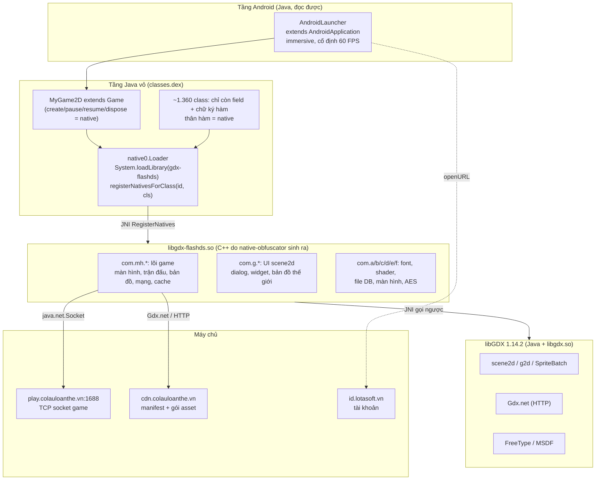
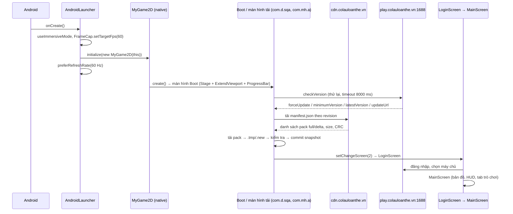
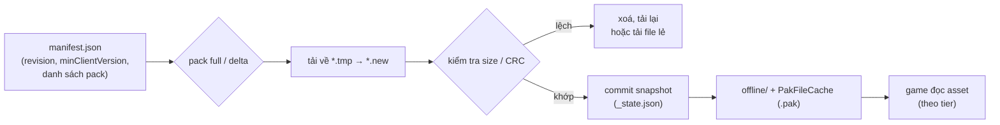

# Cờ Lau Loạn Thế: phân tích kiến trúc APK

Phân tích file `colauloanthe.1.0.0.apk` (bản 1.0.0, versionCode 2). Đây là phân tích tĩnh: chỉ đọc file APK, không chạy game và không bắt gói tin mạng.

Mỗi nhận định được đánh dấu theo độ chắc chắn:

- **[Quan sát]**: đọc trực tiếp từ file (manifest, danh sách file, tên symbol, chuỗi ký tự, chữ ký hàm Java).
- **[Suy luận]**: rút ra từ nhiều quan sát gộp lại. Hợp lý nhưng chưa được chứng minh bằng việc chạy code.
- **[Chưa rõ]**: không xác định được bằng phân tích tĩnh.

---

## 1. Tóm tắt

| Hạng mục | Kết quả |
|---|---|
| Engine | **libGDX 1.14.2** (Java), backend Android [Quan sát] |
| Ngôn ngữ gốc của game | Java (bytecode) [Quan sát]. Không thấy code game nào dùng Kotlin [Quan sát] |
| Nơi chứa logic game | Gần như toàn bộ đã **dịch sang C++ native** trong `libgdx-flashds.so` (1.360 class) [Quan sát] |
| Bảo vệ code | R8 đổi tên class (`sqa`, `sqb`…), sau đó native-obfuscator dịch bytecode sang C++/JNI [Quan sát + Suy luận về tên công cụ] |
| UI | scene2d (`Stage`, `Table`, `Dialog`, `Widget`), `ExtendViewport`, font MSDF [Quan sát] |
| Mạng | TCP socket tự viết tới `play.colauloanthe.vn:1688`, cộng HTTP (`Gdx.net`) cho kiểm tra phiên bản và tải asset từ `cdn.colauloanthe.vn` [Quan sát chuỗi + Suy luận vai trò] |
| Tài nguyên | 255 file `.dat` mã hoá **AES/ECB/PKCS5Padding**, cộng hệ thống tải gói asset theo revision (full/delta) [Quan sát + Suy luận] |
| Thể loại | RPG online nhiều người chơi, trận đấu theo lượt trên bàn cờ (đổi chỗ quân, kỹ năng, vật phẩm), có PvP, bang hội (sứ quân), bản đồ thế giới [Suy luận từ chuỗi] |
| Dung lượng | 212,6 MB, trong đó **92,7% là thư viện native** (riêng `libgdx-flashds.so` ×4 ABI ≈ 195 MB) [Quan sát] |

---

## 2. Thông tin gói

Nguồn: `aapt2 dump badging/xmltree` và REA `inspect_apk_signature`.

| Thuộc tính | Giá trị |
|---|---|
| Package | `com.lotasoft.colauloanthe` |
| Tên hiển thị | Cờ Lau Loạn Thế |
| versionName / versionCode | `1.0` / `2` (trong code ghi `"1.0.0"`) |
| minSdk / targetSdk / compileSdk | 24 / 36 / 36 |
| Android Gradle Plugin | 8.9.3 (`META-INF/com/android/build/gradle/app-metadata.properties`) |
| Git revision lúc build | `8353f01a24bfd41994a402c6ddb4181be3eddec3` (`META-INF/version-control-info.textproto`) |
| ABI | `arm64-v8a`, `armeabi-v7a`, `x86`, `x86_64` |
| OpenGL ES | 2.0 (`uses-gl-es 0x20000`) |
| Hướng màn hình | Ngang (`screenOrientation=6`, sensorLandscape) |
| `extractNativeLibs` | `false` (thư viện `.so` để nguyên trong APK, không nén) |
| Quyền | `INTERNET`, `VIBRATE`, `READ_MEDIA_AUDIO`, `READ_EXTERNAL_STORAGE` (≤ API 32) |
| Component | 1 activity `com.tlgdx.twelvelord.android.AndroidLauncher`. Ngoài ra chỉ có component của AndroidX (`InitializationProvider`, `ProfileInstallReceiver`) |
| Chữ ký | Chỉ có APK Signature Scheme **v2**, 1 signer, chứng chỉ SHA-256 `76a91aaf531c46544287a42cf7ad82c4bfc5f4179aa5a0eb2a2ed74f34e24f17`. Không có v1/v3, không có xoay vòng khoá. REA chỉ kiểm tra digest khớp với nội dung file, **không** xác minh chữ ký mật mã. |

### Thư viện đi kèm [Quan sát]

| Thư viện | Phiên bản | Ghi chú |
|---|---|---|
| libGDX core + Android backend | 1.14.2 (`com.badlogic.gdx.Version`) | Gồm scene2d, g2d, freetype, assets. R8 vẫn giữ cả g3d và maps/tiled |
| `libgdx.so`, `libgdx-freetype.so` | native chuẩn của libGDX | Có 59 và 68 hàm JNI `Java_com_badlogic_gdx_*` |
| msdf-gdx (`com.maltaisn.msdfgdx`) | — | Font dạng multi-channel signed distance field |
| AndroidX core | 1.17.0 | Kèm lifecycle, startup 1.1.1, profileinstaller 1.3.0 |
| kotlinx-coroutines | 1.8.1 | Do AndroidX kéo vào. Không có class game nào import `kotlin.*` |

---

## 3. Bố cục APK

411 file, tổng dung lượng chưa nén khoảng 214,7 MB [Quan sát]:

| Nhóm | Dung lượng | Tỷ lệ |
|---|---|---|
| `lib/*/libgdx-flashds.so` (4 ABI) | 195,0 MB | ~90,8% |
| `lib/*/libgdx.so` + `libgdx-freetype.so` | 4,1 MB | ~1,9% |
| `assets/` | 12,0 MB | ~5,6% |
| ↳ `assets/audio` (mp3/ogg/wav) | 5,0 MB | |
| ↳ `assets/msdf` (font MSDF `.fnt` + `.png`) | 3,2 MB | |
| ↳ 255 file `.dat` mã hoá | 3,1 MB | |
| `classes.dex` | 2,6 MB | |
| `res/` | 0,8 MB | |

Kích thước `libgdx-flashds.so` theo ABI: x86 60,2 MB · x86_64 50,4 MB · arm64 48,7 MB · armv7 35,6 MB.

### Cây thư mục `assets/` [Quan sát]

```
assets/
├── assets.txt          # danh sách 301 đường dẫn asset (index của libGDX)
├── audio/              # nhạc nền: title, worldmap, lv1, battle, charcreation; hiệu ứng: attack, lvu, useitem, vs
├── msdf/               # font MSDF: Azuki, chelthm, font_barmeneb, playfull_rocket (+ biến thể _d)
├── f/                  # font TTF gốc (Saira, Azuki, chelthm…) + ver.dat
├── shaders/            # font.vert/frag (distance field), recolor.vert/frag (đổi màu)
├── x1/                 # asset mức "x1": play/, skill/, ui/ (188 file .dat)
├── play/ info/ corner/ dialog/ createcs/
├── chess0b…chess8b.dat # hình quân cờ
└── *.dat               # hiệu ứng: aura, barrier, firerage, ice, zap, magicgate…
```

---

## 4. Kiến trúc tổng thể



### Cách code thật sự chạy [Quan sát + Suy luận]

1. Mỗi class game trong `classes.dex` chỉ còn lại field, constructor đơn giản và các hàm khai báo `native`. Ví dụ `MyGame2D`:

   ```java
   public class MyGame2D extends Game {
       static {
           Loader.registerNativesForClass(688, MyGame2D.class);
           Hidden0.special_clinit_688_160(MyGame2D.class);
       }
       public native void create();
       public native void dispose();
       public native void pause();
       public native void resume();
       ...
   }
   ```

2. `native0.Loader` nạp `libgdx-flashds.so`. Khối `static` của mỗi class gọi `registerNativesForClass(id, cls)` để đăng ký thân hàm C++ qua JNI `RegisterNatives`. Thư viện không có hàm `Java_*` nào được export [Quan sát: 0 symbol `Java_`].
3. Thân hàm nằm trong namespace `native_jvm::classes::__ngen_<package>_<Class>_<id>` (18.531/19.265 symbol export). Có các bảng `string_pool`, `cclasses`, `cmethods`, `cfields`, và chuỗi lỗi kiểu `INVOKEVIRTUAL Int npe`, `GETFIELD Object npe`. Các chuỗi này mô phỏng từng lệnh bytecode JVM.
4. Code C++ gọi ngược lại libGDX và Java SDK qua JNI (`FindClass`, `GetMethodID`…). Vì vậy libGDX vẫn chạy ở dạng Java bình thường.

Các dấu hiệu `native_jvm`, `native0/Loader`, `native0/hidden/Hidden0`, `registerNativesForClass` và `special_clinit_*` khớp với đầu ra của công cụ mã nguồn mở **native-obfuscator** (radioegor146) [Suy luận: khớp mẫu, không có metadata ghi tên công cụ]. `.so` được biên dịch bằng NDK clang và nhúng tĩnh libc++ (`std::__ndk1`, libunwind) [Quan sát].

Số class đã dịch sang native, theo package [Quan sát, đếm từ symbol]:

| Package | Số class |
|---|---|
| `com.g.*` | 663 |
| `com.mh.*` | 596 |
| `com.d.*` | 43 |
| `com.f.*` | 28 |
| `com.tlgdx.twelvelord.*` | 16 |
| `com.a/b/c/e` | 14 |
| **Tổng** | **1.360** |

---

## 5. Luồng khởi động



Bằng chứng [Quan sát chuỗi trong `libgdx-flashds.so`]: `BootTask chay lan thu`, `gui checkVersion lan`, `khong nhan duoc reply checkVersion sau 8000ms`, `nhan reply checkVersion: forceUpdate=`, `Version check CHAN: client 1.0.0 < minimumVersion`, `Version check bo qua (fail-open)`, `onStart -> setChangeScreen(2) (LoginScreen)`, `init Login Screen`, `login success`, `MainScreen`.

Thứ tự các bước trong sơ đồ là **[Suy luận]**. Thông điệp checkVersion đi qua socket hay HTTP thì **[Chưa rõ]**.

---

## 6. Phân rã module

Tên package và class đã bị R8 đổi thành dạng `sqXX`. Vai trò dưới đây được suy ra từ class cha, các import libGDX, chữ ký hàm và chuỗi hằng còn lại trong Java [Suy luận].

| Package | Vai trò | Dấu hiệu chính |
|---|---|---|
| `com.tlgdx.twelvelord` | Điểm vào, cấu hình nền tảng | `MyGame2D extends Game`, `MainGame.main(String[])` (launcher desktop), `sqj` (loại platform, kích thước thiết kế), `sqa` (bảng màu hex), `sqg` (`FrameBuffer`), `sqp` (tên icon) |
| `com.tlgdx.twelvelord.android` | Launcher Android | `AndroidLauncher`, `BrowserLauncher.openURL` |
| `com.d` | Màn hình (`Screen`) | `com.d.sqa implements Screen` với `ExtendViewport`, `ProgressBar` (màn hình tải) |
| `com.mh` (339 class gốc) | **Lõi game** | `sqjt implements Screen, InputProcessor` (màn hình chính: `Stage`, `InputMultiplexer`, `OrthographicCamera`), `sqni` (mở `Socket`, timeout 8000), `sqnw` (luồng `socket-reader`), `sqdo` (`DataInputStream`), `sqkr`/`sqkq` (PlayingTabView, controller trận đấu), `sqhz` (MapTabView), `sqqy` (xem trận), `sqeq` (nạp font MSDF), `sqge` (hiệu ứng), `sqkh` (cài đặt `gfx_quality`, `move_mode` joystick/dpad), `sqlk`/`sqlm` (thoại thắng/thua) |
| `com.mh.a` | Boot, kiểm tra phiên bản | dùng `Gdx.net`, chuỗi `Boot`, `"Đã có phiên bản mới…"`, `android`/`ios` |
| `com.mh.o` | Cache gói asset offline | `RandomAccessFile`, `offline`, `pack-`, `_state.json`, `_pending.json`, `.new`, `.tmp`, `full`/`delta` |
| `com.mh.r` | Shader đổi màu (palette swap) | `ShaderProgram`, `Pixmap`, `Recolor` |
| `com.mh.n` | Trạng thái kết nối, GL | `"Đang kết nối máy chủ..."`, `"Mất kết nối…"`, `GL20` |
| `com.mh.s` | Sứ quân (bang hội) | `"Tên sứ quân dài 4 đến 14 ký tự…"` |
| `com.mh.q` | Bảng xếp hạng | `"Bảng xếp hạng"`, `"Hạng"` |
| `com.mh.j` | Vật phẩm, trang bị | `"Độ bền:"`, `"Phẩm chất:"`, `"Chưa đủ cấp độ yêu cầu"` |
| `com.mh.k` | Tương tác người chơi, lôi đài | `"…chặn khiêu chiến và giao dịch"`, `fake-loidai-`, `LinkedBlockingQueue` |
| `com.mh.p` | Luồng nền, pet | `ThreadFactory`, `idle_flavor` |
| `com.mh.g` / `com.mh.h` | Chân dung, drawable | `PortraitCapture`, `SmallImage`, `TierImage`, `NinePatch` |
| `com.mh.e` | Đập trứng | `"Bạn không đủ Xu để đập trứng…"` |
| `com.mh.d` | Ghi crash log | `crash-`, `.log` |
| `com.g.c` (59) | **Dialog** scene2d | `Dialog`, `Table`, `Button`. Hòm thư, VIP/phúc lợi, chọn máy chủ, chi tiết vật phẩm, cẩm nang, chat |
| `com.g.m` (88) | **Widget** tự viết | `Widget`, `WidgetGroup`, `ScrollPane`. Nhiệm vụ ngày (`LOGIN_DAILY`, `KILL_MOB`…), mã quà tặng, túi đồ |
| `com.g.d` | Bản đồ thế giới, chợ | `WorldMap`, `"Vào thành"`, `"Đăng bán"`, `"Nhập giá"` |
| `com.g.l` | Hướng dẫn tân thủ | `NewbieGuide`, `"Chào mừng bạn đến với thế giới của Cờ Lau Loạn Thế!"` |
| `com.g.e` | Cẩm nang | `offline/cam-nang.json` |
| `com.g.j` | UI sứ quân | `"Sứ quân"` |
| `com.g.sqd` | Skin, style | style `lb-regular-14/16/18`, `lb-azuki-24`, `dlg-white`, `dlg-no-bg` |
| `com.a` | Vẽ chữ | `BitmapFontCache` |
| `com.b` | Shader font distance field | `shaders/font.vert`, `shaders/font.frag` |
| `com.c` | File/DB cục bộ | `clloanthe.db`, `FileHandle` |
| `com.e` | Mã hoá AES | `"AES/ECB/PKCS5Padding"`, `SecretKey` |

---

## 7. Mạng

### Socket game [Quan sát chuỗi + Suy luận]

- Địa chỉ: `play.colauloanthe.vn:1688` (chuỗi trong `.so`).
- `java.net.Socket` tự viết (`com.mh.sqni`), timeout kết nối 8000 ms (`f4982c = 8000`).
- Có luồng đọc riêng `SocketReader` (thread tên `socket-reader`), đọc `InputStream` qua `DataInputStream`. Vậy đây là **giao thức nhị phân tự định nghĩa**, không phải HTTP/JSON và không phải WebSocket.
- Có xử lý `keep-alive het han`, `mat ket noi`, `noi lai duoc` (kết nối lại), `server yeu cau chuyen IP` (máy chủ chỉ định IP khác) và `Service.closeSocket`.
- Đồng bộ trạng thái: `SQControllerManager.checkSumToSyncDataWithServer()`. Gợi ý có checksum so khớp dữ liệu giữa client và server.

Định dạng gói tin, mã lệnh và cơ chế mã hoá kênh truyền (nếu có): **[Chưa rõ]**. Muốn biết phải phân tích sâu code native hoặc bắt traffic khi chạy.

### HTTP [Quan sát]

| Endpoint | Mục đích (suy luận) |
|---|---|
| `https://cdn.colauloanthe.vn/` | Tải `manifest.json` và các gói asset (`assetBaseUrl`, `baseUrl`) |
| `https://id.lotasoft.vn` | Hệ thống tài khoản Lotasoft |
| `https://lotasoft.vn/chinh-sach-bao-mat`, `/dieu-khoan-su-dung` | Chính sách, điều khoản |
| Facebook, Facebook Groups, TikTok, Zalo | Link cộng đồng, mở qua `BrowserLauncher.openURL` |

---

## 8. Tài nguyên và cập nhật nội dung

### Asset trong APK [Quan sát]

- Có 255 file `.dat`. Tất cả có kích thước là bội số của 16 và entropy khoảng 7,94–7,98 bit/byte. Code chứa `AES/ECB/PKCS5Padding`, các chuỗi lỗi `decrypt: do dai phai la boi so 16`, `unpadPKCS7: padding khong hop le` và lớp `com.e.sqa`. Vậy `.dat` là **ảnh/dữ liệu mã hoá AES-ECB**.
- Trong code, asset được gọi bằng tên `.png` (ví dụ `ui/a00.png`, `strwin.png`, `blacksmith.png`) nhưng file thật là `.dat` cùng tên. Lớp nạp asset sẽ ánh xạ đuôi `.png` sang `.dat` rồi giải mã [Suy luận].
- Khoá AES không nằm ở dạng hằng trong Java (`f294b`, `f295c` đều được khởi tạo trong native) [Quan sát]. Giá trị khoá: **[Chưa rõ]**, phân tích này cũng không tìm cách trích xuất.
- Thư mục `x1/` gợi ý có nhiều mức độ phân giải asset. Code có chuỗi `asset_tier`, `gfx_quality` với `low`/`normal`/`high` [Quan sát chuỗi, Suy luận ý nghĩa].

### Hệ thống tải gói theo revision [Quan sát chuỗi + Suy luận]



Bằng chứng: `revision`, `targetRevision`, `Commit xong revision`, `Chay bang snapshot da commit revision`, `pack full thieu file`, `pack delta phu het snapshot`, `sai size/crc, bo qua`, `CRC lech tai`, `PakFileCache: pak`, `format .pak khong doc duoc`, `Tu choi content: client 1.0.0 < minClientVersion`, `Nguoi choi tu choi tai du lieu, thoat game`, `offlineResMode=true`, `BodyAtlasStore`, `EffectAtlasStore`, `.meta thieu hoac khong phai v3`, `.fx thieu hoac khong phai v2`.

Kết luận: APK chỉ chứa bộ asset tối thiểu. Phần lớn đồ hoạ nhân vật, hiệu ứng và bản đồ được tải từ CDN, ghi vào bộ nhớ trong theo kiểu giao dịch (tải ra file tạm, kiểm tra, rồi mới commit) để chịu được khi mất mạng giữa chừng.

---

## 9. Đồ hoạ và UI

| Thành phần | Chi tiết | Mức |
|---|---|---|
| Khung màn hình | `Game` → các `Screen`. Màn hình chính dùng `Stage` + `InputMultiplexer` + `OrthographicCamera` | Quan sát |
| Viewport | `ExtendViewport(sqj.f5399a, sqj.f5400b)`. Kích thước thiết kế được gán trong native | Quan sát (giá trị: Chưa rõ) |
| UI | scene2d.ui: `Dialog`, `Table`, `ScrollPane`, `Stack`, `TextField`, `NinePatchDrawable`. Rất nhiều widget tự viết kế thừa `Widget`/`WidgetGroup` | Quan sát |
| Font | msdf-gdx với 5 họ font, mỗi họ có biến thể `_d`. Shader distance field riêng (`shaders/font.frag`) có outline, shadow, inner shadow (`outlineColor`, `shadowOffset`, `innerShadowRange`…). Có FreeType cho TTF | Quan sát |
| Đổi màu | Shader `recolor` dùng uniform `u_mask`, `u_ramps`, `u_row`: đổi màu theo palette ramp cho trang phục/nhân vật | Quan sát chuỗi, Suy luận mục đích |
| Nhân vật/hiệu ứng | Atlas theo trang (`BodyAtlasStore`, `EffectAtlasStore`), nhân vật nhiều lớp (`useLayeredCharacter`, `useLayeredEffect`), animation theo khung (`Frame animate`), trạng thái `idle`/`move`/`emote`, kiểu di chuyển `walk`/`fly`/`jump`/`hang` | Quan sát chuỗi |
| Hiệu năng | Cố định 60 FPS (`FrameCap`), chọn tần số quét gần 60 Hz nhất. Có overlay debug: `FPS %.1f | ticks/s`, `slow frame: gap … tick … paint … stage …` | Quan sát |
| Điều khiển | Cảm ứng, joystick ảo/dpad (`move_mode`, `btn-analog-*`). Còn dấu vết phím tắt desktop (`F4`, `F5`, `F12`) | Quan sát chuỗi |
| Âm thanh | Nhạc nền theo cảnh (title, world map, lv1, battle, tạo nhân vật), hiệu ứng `.wav` | Quan sát |

---

## 10. Gameplay suy ra từ chuỗi

Toàn bộ phần này là [Suy luận] dựa trên chuỗi hằng và log.

- **Trận đấu theo lượt trên bàn cờ:** `Nodechess id`, `PlayingChess`, `SQControlManager.processSwapChess()`, `receive opponent swap node`, `isBlueTurn`, `receiveTurn`, `turnReadyNumber`, `keepTimerNextTurn`, quân cờ `chess0b…chess8b`, `chesscrystal`. Thanh HP, mana, power (`hpbar`, `manabar`, `powerbar`). Có kỹ năng (`process use skill`, `receive skill affect`), vật phẩm (`process use item`) và phản đòn (`process attack reverse`). Lối chơi giống puzzle-RPG kiểu "đổi chỗ quân", đối kháng 1–1.
- **Thế giới MMO:** bản đồ thế giới (`WorldMap`, `"Vào thành"`), map có NPC (`"Nói Chuyện"`), nhặt đồ (`"Nhặt"`), đánh quái và boss (`KILL_MOB`, `KILL_BOSS`, `"Bạch Hổ Thống Lĩnh"`).
- **Nhân vật:** tạo nhân vật (`createcs`, nhạc `charcreation`), cộng điểm tiềm năng, cây kỹ năng (`tree-skill`), danh hiệu, pet.
- **Kinh tế:** Xu và Xu khoá, lượng, chợ (`"Đăng bán"`), thợ rèn và sửa trang bị, cường hoá (`ENHANCE_EQUIP`), chuyển hoá (`TRANSMUTE`), đập trứng, lật thẻ.
- **Xã hội:** sứ quân (bang hội), chat thế giới và chat sứ quân, khiêu chiến, giao dịch, kết bạn, bảng xếp hạng, lôi đài.
- **Vận hành live:** VIP, nạp tích luỹ (`RECHARGE_MONTHLY`), điểm danh, quà online, mã quà tặng, hòm thư, thông báo, nhiệm vụ ngày, Bảo Điển (nhận EXP khi làm nhiệm vụ, có vẻ giống battle pass), chọn máy chủ, yêu cầu xoá tài khoản (`"Tài khoản sẽ được xóa trong vòng 7 ngày."`).

---

## 11. Lưu trữ cục bộ

- `clloanthe.db` (lớp `com.c.sqd`) và `RecordStoreManager` / `mainRecordStore` [Quan sát chuỗi]. APK **không** gói thư viện SQLite riêng. Đây có thể là kho bản ghi tự viết theo kiểu RecordStore, không phải SQLite [Suy luận].
- `_state.json`, `_pending.json`, thư mục `offline/`: trạng thái cache asset (mục 8).
- File crash log `crash-*.log` (`com.mh.d.sqa`).
- Cài đặt người chơi: `gfx_quality`, `move_mode`, lựa chọn máy chủ (`"khong luu duoc lua chon server"`). Lưu bằng cơ chế nào thì **[Chưa rõ]**: không class game nào import `com.badlogic.gdx.Preferences`.

---

## 12. Các lớp bảo vệ

| Lớp | Cách làm | Hệ quả khi phân tích |
|---|---|---|
| 1. R8/ProGuard | Đổi tên class, field, method (`sqa`, `f5399a`…). Chỉ giữ tên các class cần cho Android/libGDX | Không đọc được tên ý nghĩa |
| 2. native-obfuscator | Dịch 1.360 class sang C++, đăng ký JNI động, `string_pool` riêng cho từng class | jadx chỉ thấy khai báo `native`. Muốn đọc logic phải dịch ngược ARM64 (Ghidra/IDA) |
| 3. Mã hoá asset | AES/ECB/PKCS5Padding, khoá khởi tạo trong native | Không mở trực tiếp được ảnh `.dat` |

Ghi chú: AES ở chế độ **ECB** không che được các khối dữ liệu giống nhau. Ở đây mục tiêu chỉ là chống lấy asset nhanh, nên rủi ro thấp. Nhưng nếu dùng cùng kiểu mã hoá này cho dữ liệu nhạy cảm hơn thì nên chuyển sang AES-GCM/CTR [Nhận xét].

---

## 13. Dấu vết port từ nền tảng cũ

Phần này là [Suy luận]. Có nhiều dấu hiệu cho thấy code game được port từ một codebase kiểu J2ME/MIDP (game Java cho điện thoại phím) lên libGDX qua một lớp tương thích:

- `RecordStoreManager`, `mainRecordStore` (RMS của J2ME).
- `paint2D`, `keyPressed`, `PlatformScreen`, `setChangeScreen(n)`.
- Hướng dẫn trong game dùng ngôn ngữ phím cứng: `"Bấm phím giữa"`, `"Chọn menu trái > Cập nhật"`.
- Tên lớp `SQControlManager`, `SQControllerManager` và tiền tố `sq*` của component (`sqstringcomponent`).
- `MainGame.main(String[])` và chuỗi `-Dcolau.uitest=true`, `F12`: còn có bản build desktop (LWJGL) để test.
- Chuỗi `android` và `ios`: core libGDX có thể dùng chung cho nhiều nền tảng.

---

## 14. Giới hạn và những điều chưa xác định

- **Không chạy game, không bắt traffic.** Mọi nhận định về luồng chạy đều dựa trên phân tích tĩnh.
- **Không dịch ngược code ARM64** của `libgdx-flashds.so`. Logic chi tiết (giao thức, công thức sát thương, khoá AES, giá trị viewport) chưa được đọc.
- REA không có JADX MCP (`REA_JADX_MCP_JAR` chưa cấu hình), nên `inspect_android_package` không chạy. Phần decompile Java dùng `jadx` CLI cài sẵn trên máy, phần manifest dùng `aapt2`.
- Vai trò package ở mục 6 được suy ra từ import và chuỗi, có thể lệch ở các package nhỏ.
- Chữ ký APK chỉ được kiểm tra tính tự nhất quán (digest khớp nội dung), **không** xác minh mật mã hay danh tính người ký.

---

## Phụ lục A: định danh file

| File | SHA-256 |
|---|---|
| `colauloanthe.1.0.0.apk` (212.642.494 byte) | `83a8ed62a81a95d295eac909f59c322c634afcd750c745fd6a7f5015fcce6e06` |
| `lib/arm64-v8a/libgdx-flashds.so` (48.686.032 byte) | `fe1312b4d1c26f962e7c255852a9a6a1dc2fb664f0a0f79df7ab0dc7c07e1926` |
| GNU build-id của file `.so` trên | `91548129ab1092387f87f357fd26b9e01b0a2af0` |

## Phụ lục B: Evidence ID của REA

| Phép kiểm tra | Evidence ID |
|---|---|
| Chữ ký APK (`inspect_apk_signature`) | `ev_520d9f84eae95cd18fa5f7abbd0d4e47de5d001a7930ce206392403ff82c7f7a` |
| Danh sách file APK (`inspect_artifact`) | `ev_b4546258d42f4173ed0a6f4071aa87397f077c3b45f791b0b0e80e4cf3679e13` |
| Export của `libgdx-flashds.so` (`inspect_native_exports`) | `ev_d1bea3f47ecccaeb19244e9c78c5db96672c3bfa63a8b7f9fd9d40bc4dc3b680` |
| ELF notes (`inspect_elf_notes`) | `ev_34ce352a0001e89ac6bb904a2cbd45f7fee44269536f3996cc9130ee8c3c3b9c` |
| Rust metadata (`inspect_rust_binary`, không có) | `ev_94014cd0723f89d914beb6026c8b0d70bbf523ea0f94e74a515085ce528c7474` |

## Phụ lục C: tái tạo phân tích

```bash
APK=colauloanthe.1.0.0.apk
BT=~/Library/Android/sdk/build-tools/37.0.0

# Thông tin gói và manifest
$BT/aapt2 dump badging $APK
$BT/aapt2 dump xmltree --file AndroidManifest.xml $APK

# Giải nén vào thư mục tạm riêng
mkdir -p /tmp/apk_x && unzip -q $APK 'classes.dex' 'lib/arm64-v8a/*' -d /tmp/apk_x

# Decompile Java (chỉ thấy khai báo native)
jadx --no-res -d /tmp/jadx_out /tmp/apk_x/classes.dex

# Đếm symbol do native-obfuscator sinh ra (không phải số class)
strings -n 6 /tmp/apk_x/lib/arm64-v8a/libgdx-flashds.so | grep -c '^_ZN10native_jvm'
```
